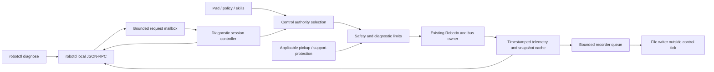

# Robot diagnostics and bounded actuator tests

**Proposal for review — not implemented.** This page owns the proposed diagnostic session,
its API and records. The existing control loop and bus belong to
[robotd-design.md](robotd-design.md); authority and transports to
[architecture.md](architecture.md); deployment to [updater-design.md](updater-design.md).

## 1. Problem and scope

An operator wants to inspect or exercise any of the robot's 15 motors independently while
the robot is mechanically supported in front of an external camera. Today, inspecting joint
telemetry works, but `robot.init` moves all joints and skills replace the ordinary controller.
Neither is an isolated actuator test. A separate serial script would fight robotd for its bus.

The useful product is a small diagnostic instrument inside robotd, not a general scripting
engine: inspect first, preview a finite experiment, acquire exclusive authority, run it under
on-board bounds, and export enough evidence to explain the result. The same path should support
inspection and individual testing of **all 15 motors**, including the mouth, replacement
commissioning and later calibration reference measurements. All-motor coverage is a release
requirement. No motor has a privileged API, implementation path or commissioning order.
It must not infer calibration from walking asymmetry or silently alter the robot to make a test pass.

### Evidence behind this proposal

The baseline inspected is 0.17.9, commit `96b89d8613f06722c1d64ce75ab0d7124fed9d8f`, API 44.
Two short supervised starts on graphite-boom reached approximately 13 cm of contact odometry
and 21° yaw before their heading bound stopped them. In the cooler trial the left/right knee
mean absolute target errors were approximately 25°/21°, with mean current magnitudes 195/142 mA.
These are startup samples under different conditions, not matched steady gait cycles, an
independent displacement reference, or evidence of a bad zero. They do not establish a bus fault.

A later connected inspection found a healthy 50 Hz loop, CPU 50°C without reported throttling,
motors at most 31°C and no consecutive bus errors. The USB C922 showed the supported robot
lying on a table, with one leg partly hidden. No isolated motor test was executed. Its installed
API has no per-joint target command. Existing pickup code watches walk/stand, not homing or skills.
The diagnostic design must address that gap rather than calling one of those modes a test.

## 2. Questions the instrument should answer

| Question | Evidence to expose | What it cannot conclude alone |
|---|---|---|
| Is this the right robot, motor and configuration? | Persistent robot identity, model/firmware, joint/ID map, motor installation generation, software and policy digests, effective parameters | A bus ID is not a unique physical serial number |
| Are electronic settings correct? | Expected/read homing, operating/drive modes, torque, gains, limits and startup corrections with timestamps | Correct EEPROM does not prove horn alignment |
| Does a joint follow a modest command? | Measurement, generated target, safety-applied target, write outcome and previous command sequence | Same-tick subtraction is not a settled response |
| Is there backlash or friction? | Slow approaches from both directions, repeated unloaded poses, external angle reference | Encoder motion alone cannot observe output-link backlash |
| Is the effect load-dependent? | Paired left/right runs with support/load annotations, voltage and current | Current magnitude is not joint torque or force direction |
| Is the bus or computation unhealthy? | Freshness, read/write failures, repeated IMU blocks, loop timing, CPU throttle and servo faults | A healthy snapshot cannot rule out intermittent failures |
| Is thermal drift involved? | Per-motor temperature, CPU temperature, throttle, time since start, comparable run conditions | CPU and motor temperatures are different measurements |
| Is pickup protection actually available? | Configured, loaded, applicable, warming, watching, paused or fault, model/profile revision and reason | `picked_up=false` does not mean protection is ready |
| Is the physical zero wrong? | Repeated external-reference angles versus encoder coordinates, with uncertainty and approach direction | Neither gait drift nor target error identifies a physical zero |
| What happened before the stop? | Bounded pre-trigger history, first stop reason, subsequent faults and applied actions | Missing or downsampled frames are not stationary readings |

## 3. Architecture: one bus owner, one active experiment



No daemon, serial port or HTTP server is added. `robotd/src/diagnostics.rs` owns a small pure
state machine and trajectory generator. Existing IPC tasks validate request shape and submit
bounded commands; only the control thread validates live conditions and accepts transitions.
The RPC handler never blocks the control tick or directly accesses the bus. Admission returns
an acknowledgement with an operation ID; the committed outcome appears in status/events.
Mailbox full means `busy`, not an unbounded queue of movements.

The diagnostic controller supplies targets through the existing Safety/RobotIo path, with
additional validated anatomical, velocity, acceleration, effort and session limits. One explicit
authority selector arbitrates diagnostics against all existing power, policy, skill, body and
head paths. This is an extraction at the target-selection point, not a rewrite of unrelated
gamepad or exploration behaviour. Safety and emergency torque-off always outrank diagnostics.

Read-only inspection uses cached telemetry and scheduled slow reads by the existing owner.
Startup must retain the values read *before* automatic correction, expected values, attempted
writes and readback; an audit must not pretend that starting robotd was a read-only operation.
Optional extra registers are read on a bounded schedule whose measured bus budget fits the tick;
otherwise the snapshot reports incomplete/stale. No synchronous bulk register scan while moving.

The diagnostic boundary is explicit: robotd owns actuators/body sensing; existing padd/configd
interfaces diagnose input/pairing, mediad diagnoses camera/audio, and tofd diagnoses depth/head
sensing. The laptop CLI may collect their read-only health and version snapshots into one
support bundle. It does not introduce competing configuration APIs or make those daemons depend
on robotd's recorder. Useful passive additions are error-triggered capture (bus fault, repeated
IMU data, loop overrun or pickup error) with finite pre/post windows and a cooldown, never a
trigger that starts motion. No reboot, service restart or repair is hidden in a diagnosis command.

### Authority and lifetime

States: `idle → acquired → armed → running → stopping → acquired → closed`. Any active state
can enter `faulted`; a fault requires a new inspected session, never automatic rearm. `acquired`
owns admission but does not enable torque. `armed` is a short-lived readiness check, not motion.
Ownership is granted only after the previous controller is quiescent and joint velocity is within
the profile's quiet threshold. A walking robot gets `controller_active`; acquisition does not
silently stop, sit, relax or stand it.

One session, at most one finite run. The session is tied to Unix peer credentials, the originating
connection and robot boot epoch. Its opaque token is an additional anti-mixup value, not a
replacement for authorization. Reconnect can read the report but cannot revive the lease.
Keepalive renews a bounded on-board deadline; suggested initial values for review are a 100 ms
client period and 300 ms expiry. Their suitability must be measured under normal scheduling.
An absolute session duration and per-run duration prevent keepalive from granting unlimited motion.

While owned, mutating pad, head/look, mouth, skill, policy-load, init and mode requests are rejected with
`diagnostic_owned`; continuous notifications are discarded and counted. Telemetry names the
owner and suppressed source. Old intents, pending skills and enabled-state requests are cleared
on entry and exit. No automatic return to an old policy, no delayed pad command on release.
The pad's explicit emergency action and authorized `robot.relax` remain effective. A release
must not block that stop while waiting for the ordinary mailbox.

`robot.safeToRestart` is false from acquisition through stopped/closed, including torque-on
holds and report finalization needed for recovery. The updater continues to own its own gate.
Crashes and power loss are not covered by a software keepalive: use the servo hardware watchdog
only after confirming its behaviour for this hardware/mode and integrating its readback and
recovery. Motorized commissioning is gated on a tested host-loss stop; do not claim that an
in-process state machine alone makes a wedged process stop servos.

## 4. Protection and bounded motion

### Pickup applicability is a release gate

Keep the current pickup configuration enabled. Its classifier was trained on walk/stand
features, not arbitrary unloaded joint sweeps with the trunk on its back. Running it outside
that domain, or setting `watching=true`, does not establish protection. Do not spoof features,
freeze a probability, raise thresholds, or disable it for diagnostics.

Expose `pickup.applicable` separately from enabled/loaded. The first diagnostic release can
ship inspection and dry-run previews while motorized profiles remain unavailable with
`protection_not_applicable`. This is an explicit product state, not a hidden TODO.

The proposed motorized profile is `supported_supine_v1`, initially **unvalidated**. It needs a
diagnostic support/lift guard in addition to the enabled pickup detector: baseline body
orientation and angular-rate limits, support/pose changes, valid sensor freshness, and a
qualified response to lifting or loss of support. An operator's support confirmation records
setup; it is not a sensor. IMU alone cannot reliably identify slow translation or all support
loss. Validate on a physical fixture and relevant lift cases; if existing sensors cannot meet
the detection requirement, require an independent support interlock before enabling the profile.
An invalid or out-of-domain verdict aborts motion. Do not expose a `force` option.

For supported diagnostic tests, pickup/support uncertainty means stop and remain latched, not
resume the test. The current classifier error path can release its pause; diagnostics needs a
separate fail-closed admission/abort rule. It must preserve existing walk behaviour rather than
silently changing it. Any new classifier requires independent validation data and its own
profile/model digest. Selecting a bench profile does not authorize an unvalidated safety model.

### Profiles, not arbitrary actuator access

A profile is compiled/validated robot data: permitted joint set, fixture and orientation,
per-joint and coupled collision constraints, travel interval, maximum excursion from acquisition,
speed/acceleration, gain, current/temperature/voltage limits, run time and stop action. It is
bound to the hardware/MJCF and coordinate convention. No such supine profile is approved today.
The ±π actuator clamp is insufficient; there is no generic safe test amplitude for every pose.

Initial active primitive, available to every one of the 15 named motors through its qualified
profile: one-joint `approach_hold_return`, with a smooth bounded trajectory,
returning to its acquisition angle only on normal completion. Multiple repeats are finite.
Then `bidirectional_sweep` within the same envelope and `paired_compare`, executing left and
right serially under explicit mirrored coordinates. Independent simultaneous joint tests and
arbitrary keyframes are deferred. A user can request lower limits, never exceed the profile.

### Required coverage: all 15 motors

Use `duck-ipc-proto::JOINT_NAMES` and `JOINT_IDS` as the authoritative inventory. Do not derive
the testable set from the policy action vector: the mouth is absent from that vector but is
still an independently testable actuator. Every primitive uses this same name/ID mapping.

| Motor | Bus ID | Profile constraints to qualify |
|---|---:|---|
| `left_hip_yaw` | 20 | Supported trunk; foot/leg sweep clear of table, opposite leg and cables |
| `left_hip_roll` | 21 | Supported trunk; lateral leg clearance and coupled hip configuration |
| `left_hip_pitch` | 22 | Supported trunk; hip/knee/ankle configuration and table clearance |
| `left_knee` | 23 | Supported thigh/leg; knee travel and foot clearance |
| `left_ankle` | 24 | Supported leg; foot travel, shell and table clearance |
| `neck_pitch` | 30 | Independently supported head; neck/head chain, cable and shell clearance |
| `head_pitch` | 31 | Head support; neck/head coupled clearance and camera orientation |
| `head_yaw` | 32 | Neck pose, cable twist, shell and lateral sweep clearance |
| `head_roll` | 33 | Head support, cable and shell clearance; gravity load recorded |
| `mouth` | 34 | Beak opening interval, linkage/pinch clearance and conservative effort limits |
| `right_hip_yaw` | 10 | Same checks as left yaw, with explicit right-side coordinates |
| `right_hip_roll` | 11 | Same checks as left roll, with explicit right-side coordinates |
| `right_hip_pitch` | 12 | Same checks as left pitch, with explicit right-side coordinates |
| `right_knee` | 13 | Same checks as left knee, with explicit right-side coordinates |
| `right_ankle` | 14 | Same checks as left ankle, with explicit right-side coordinates |

These are qualification requirements, not approved numerical limits. A single supine setup
need not allow all axes safely. Profiles may cover leg, supported neck/head and mouth setups
separately; each declares its support, applicable protection, selected joint bounds and other
joint behaviour. The normal mouth open/close range is useful model data, not by itself a
qualified diagnostic envelope. Do not move the head to expose a camera view as an implicit
side effect of testing a leg or the mouth.

Each motor must support passive inspect/record, dry-run preview, and—once its profile is
qualified—individual approach/hold/return and bidirectional sweep. Mirrored paired comparison
applies to the five left/right leg pairs; unpaired head/mouth joints support repeated
before/after comparison instead. A blocked or absent motor still has an inventory entry with
the precise reason; it is never silently omitted or reported as passing.

An optional `suite` is only a finite ordered list of these existing single-joint experiments,
not a new trajectory language. Preview displays all 15 coverage results and groups requiring
a setup change. The operator confirms the new setup before each group; re-acquire, fresh
snapshots and protection readiness are required after a change. Only one motor is exercised
at a time. No automatic all-body homing, simultaneous sweep or unattended progression.
Stop/fault aborts the suite; continuing requires an explicitly prepared new run.

Non-selected joints are either torque-off or hold-at-entry, declared per profile and exposed
in preview. Do not assume zero target is harmless. V1 should prefer torque-off on non-selected
joints when the fixture supports them. If the backend cannot guarantee selective torque/gain
and readback, refuse that profile; do not energize all fifteen servos as a fallback.

Before arming and again before the first write: require fresh sensor/torque/register snapshot,
matching robot and installation identity, no hardware errors, validated profile/protection,
allowed orientation and travel, quiet state, current budget and recorder readiness. Arming
expires; any state/config/policy change invalidates a prepared plan. Motorized v1 permits no
runtime gain tuning, torque mode, arbitrary EEPROM writes, limit changes or motor reboot.

### Stopping is part of the experiment

Normal completion follows the finite planned return and deceleration. The supported bench
profile then cuts test torque and verifies it where possible. On cancel, expired heartbeat,
lost camera-required heartbeat, unexpected motion, protection uncertainty, excessive current,
temperature, voltage fault, persistent tracking error, sensor/bus staleness or loop deadline
failure, latch the reason and execute the profile's fault stop. **Do not return home on fault**:
the return could push through the obstruction that caused the fault.

The proposed supine fault action is torque-off of every joint that the profile energized; its
fixture must tolerate release. An emergency relax cuts all torque. A hardware/communication
fault may make confirmation impossible: report `stop_unconfirmed`, keep authority latched,
reject further runs and require local inspection. Successful RPC delivery is not proof of a
physical stop. Current magnitude thresholds are protection heuristics, not force control;
profiles specify persistence windows as well as hard limits and are checked every fresh tick.
The stop deadline and actual last successful command/read timestamps belong in the report.

## 5. Proposed local API

JSON-RPC 2.0, one object per line, `/run/robotd.sock`; names and shapes below are **new proposals**.
No runtime route is implemented by this document. Bump `duck-ipc-proto::API_VERSION` when the
contract is implemented and ship compatible robotd/robotctl together. The robot reports exact
profile readiness; version skew is reported, not used to invent an alternate unsafe interface.

### Inspection and recording

| Method | Request | Result |
|---|---|---|
| `robot.diagnostics.inspect` | `sections?: [identity,motors,control,safety,policy,sensors]` | Immutable cached snapshot, snapshot ID, boot epoch, per-section age/validity and pending refresh state |
| `robot.diagnostics.refresh` | `sections` | Bounded read-only refresh request/operation ID; never correct registers or change torque |
| `robot.diagnostics.capabilities` | `{}` | All 15 joint/ID entries, per-joint primitive and profile readiness/reasons, profile revisions and non-raising limits, export schema |
| `robot.diagnostics.status` | `session_id?` | Current authority, state, readiness blockers, active run, last terminal outcome |
| `robot.diagnostics.subscribe` | `hz: 1..50, include?: [...]` | Stream with sample sequence, robot monotonic clock, freshness/drop counts and events |
| `robot.diagnostics.record.start` | `label, max_duration_s, max_bytes` | Read-only recorder ID and finite bounds; no torque or ownership implied |
| `robot.diagnostics.record.stop` | `recording_id` | Idempotent finalize acknowledgement and export ID |
| `robot.diagnostics.report` | `run_id or recording_id` | Manifest, computed summaries, completeness and artifact metadata |
| `robot.diagnostics.export.read` | `export_id, artifact_id, offset, max_bytes` | Bounded chunk, length and digest; completed artifacts only, no client-supplied filesystem path |

Each snapshot motor entry names `joint`, `id`, installation generation, identity confidence,
model/firmware, `homing_offset_counts {expected,observed,before_startup_fix}`, operating/drive
mode, hardware error, torque enable, gain P/I/D, position/PWM/current/velocity limits, voltage
and temperature. A register value carries measurement time and `valid|stale|unavailable|error`;
null/absent is never zero. Backend capability determines actual read availability. Inspect
does not claim that cached desired values are hardware readback or that missing serials exist.

The control section includes owner/source, policy and manifest digests, effective gains,
command age, generated/applied/previous-write targets, loop period/jitter and bus outcomes.
Safety includes enabled/loaded/applicable/watching pickup states, probability age when meaningful,
fall verdict, torque state and latched stop reasons. Sensor sections link the appropriate daemon
and report freshness for body/head IMU, ToF and camera; robotd does not acquire their devices.

### Exclusive active sessions

| Method | Request / response | Semantics |
|---|---|---|
| `robot.diagnostics.acquire` | `request_id, profile, profile_revision, setup_confirmed`; returns session/token and lease | No movement or torque change; reject non-quiescent controller or unavailable protection |
| `robot.diagnostics.prepare` | Session/token, `request_id, experiment`, requested lower limits | Returns finite resolved plan ID/digest, initial pose, affected joints, torque/gain plan, envelope, stop behaviour, recorder budget and blockers; no movement |
| `robot.diagnostics.arm` | Session/token, plan ID/digest | Revalidate live conditions and mark briefly ready; still no motion or torque enable |
| `robot.diagnostics.run` | Session/token, plan ID/digest, `request_id` | Control thread commits one bounded run and returns run ID; only this operation may energize the declared joints |
| `robot.diagnostics.keepalive` | Session/token, increasing sequence, `observer_ready` | Renews server-monotonic deadline within absolute session/run limits; no targets in heartbeat |
| `robot.diagnostics.stop` | Session/token, `request_id, reason` | Idempotent priority cancel, independent of ordinary mailbox capacity; returns stopping/stopped plus confirmation state |
| `robot.diagnostics.release` | Session/token | Stop first if needed, then release; no implicit policy enable or pose restoration |

All mutating calls use explicit local maintenance authorization based on Unix credentials,
separate from mere socket reachability and ordinary gamepad authority. A relay runs locally too:
locality alone is insufficient. Do not add these methods to BLE, UDP, WebRTC, remote gateways
or Space route allow-lists. Trusted SSH invokes the local CLI; no new open network listener.
Emergency relax remains available on its established authorization path without a session token.
Read-only register refresh is rate-limited per daemon, since an unauthenticated read must not
starve the bus. Recorder creation is authorized and quota-limited because it consumes disk.

Mutation envelopes reject unknown fields, non-finite values, duplicate/unknown joints, out-of-range
limits, expired sessions, mismatched boot epochs and stale plans. Every acquisition/transition
has a bounded timeout. Request IDs are deduplicated per session: same ID/same payload returns
the prior result; same ID/different payload is `request_conflict`. Retrying run never repeats
motion. A response distinguishes `queued`, `committed`, `stopping`, `stopped`, `failed` and
`stop_unconfirmed`; a client can recover an outcome by status after an acknowledgement is lost.

Common machine-readable reasons: `unauthorized`, `controller_active`, `diagnostic_owned`,
`protection_disabled`, `protection_not_ready`, `protection_not_applicable`, `profile_unvalidated`,
`unsupported_backend`, `stale_snapshot`, `stale_plan`, `joint_limit`, `coupled_limit`, `bus_fault`,
`recorder_unavailable`, `lease_expired`, `request_conflict`, `stop_unconfirmed`. Include the joint,
observed value, allowed bound and observation age when applicable; do not collapse these to
`accepted:false` with no reason.

### Example: preview a single-joint experiment

The numeric values illustrate the wire shape, **not an approved physical envelope**. Capabilities
must advertise a validated profile before acquisition. An unvalidated profile returns its blocker.

```json
{
  "jsonrpc": "2.0", "id": 7, "method": "robot.diagnostics.prepare",
  "params": {
    "session_id": "session-opaque", "token": "connection-bound",
    "request_id": "prepare-1",
    "experiment": {
      "kind": "approach_hold_return", "joint": "left_hip_roll",
      "delta_rad": 0.05, "hold_s": 0.3, "repeats": 1
    },
    "limits": {"max_velocity_rad_s": 0.1, "max_duration_s": 3.0}
  }
}
```

Initial position is taken by the server at preparation, then rechecked at run. Changes beyond
the profile tolerance invalidate the plan; never silently rebase the same digest to a new pose.
The joint name in this example is arbitrary: the same schema, state machine and qualification
rules apply to every inventory entry, including the mouth. Differences belong in profile data.
A local preview command may compute an unready plan without acquiring or arming; it carries
`executable:false` and cannot be supplied to run. No arbitrary arrays of raw Dynamixel counts.

### Operator CLI

One `robotctl diagnose` command group, backed by the same typed RPC methods:

```text
robotctl diagnose inspect --json
robotctl diagnose watch --joint left_hip_roll
robotctl diagnose record --duration 15 --label passive-joints
robotctl diagnose preview --profile supported_supine_v1 --joint left_hip_roll --delta-deg 3
robotctl diagnose test --profile supported_supine_v1 --joint left_hip_roll --delta-deg 3
robotctl diagnose stop
robotctl diagnose report <run-id>
```

These are proposed commands, not executable instructions for today's robot. Human CLI angles
may use an explicit `--delta-deg`; the wire and stored canonical values always use radians.
`test` prints the exact resolved plan, other-joint torque behaviour, duration and fault action
before arming, then requires an operator hold-to-run action. Noninteractive execution requires
an explicit observer process with the same heartbeat contract; piping stdin is not confirmation.
The laptop recording wrapper adds USB capture and `observer_ready`; it does not create a second
motor command interface. Terminal output distinguishes measured, desired, stale and unknown
values and gives concrete blockers, such as `supported_supine_v1: protection not validated`.
`diagnose stop` can issue authorized emergency cancellation without knowing an opaque token;
it cannot acquire ownership or start motion. This administrative stop is audited and still
separate from the all-joint torque-off meaning of `robot.relax`.

`robotctl diagnose list` renders the same 15-entry capabilities inventory with per-motor
inspect/preview/motion readiness. `--joint` accepts each canonical name, including `mouth`;
it is not restricted to leg joints. A future `diagnose suite --all --preview` reports coverage
and required setups without motion; executing a suite retains the per-group confirmation and
per-run API contract above. Suite reports explicitly distinguish pass, fail, blocked, skipped
and not tested for every motor, including tests aborted before their turn.

## 6. Timing, camera and reports

Record the acquisition/read sequence, generated target sequence, safety-applied target, write
attempt/outcome, and the sequence of the *previous* successful command. Sensor time precedes
the command generated from that sample. A present-position sample is not the response to the
new target in its own row. Preserve sensor sign for position/velocity; retain existing current
magnitude semantics. Add signed current only as a separately named field from raw hardware,
without changing policy/pickup features or redefining `currents_ma`.

Use robot monotonic timestamps and boot epoch for ordering; wall-clock UTC with uncertainty for
human chronology. Per-register snapshots have their own observation times; one JSON snapshot
does not imply simultaneous hardware acquisition. Gaps, stale/coasted samples and writer drops
are explicit. All buffers are bounded; the file writer never blocks a motor tick. A small
pre-trigger ring (candidate 2 s) and finite run/post-stop capture preserve context. Active tests
abort on recorder failure; passive recording reports truncation without changing robot control.
Critical stop metadata uses a reserved bounded slot even when sample storage is exhausted.

robotctl on the laptop coordinates the external USB camera; mediad continues to own onboard
media. No USB-camera dependency in robotd. Capture video before arming, mark run start/stop in
the local manifest, and record host frame times plus an estimated host↔robot monotonic mapping
from timestamp exchanges and RTT bounds. Without a hardware trigger this is approximate sync,
not frame-accurate motor latency. Video PTS alone is not an angle reference. Never make camera
pixel processing part of the 50 Hz loop.

For a supervised camera-required experiment, the laptop only sends `observer_ready=true` while
capture frames are fresh and the operator hold-to-run condition is active. A false/missing
heartbeat stops on the robot. This attests client observation readiness, not physical fixture
safety or successful live image interpretation. Headless diagnostic runs require a separately
validated setup and cannot silently fall back when camera capture fails.

One export directory per run on persistent robot storage, with bounded retention/quotas, contains:

- Manifest: schema/run/session/parent IDs, robot and installation identities, software/policy/
  profile/model/config digests, units/coordinates, setup/load/support annotations and uncertainty.
- Timestamped JSONL samples and ordered events: plan, admission, torque transitions, limits,
  bus failures, stop request, last successful writes, confirmed stop and completeness.
- Summaries by phase/joint: signed bias and MAE at settled holds, response/settling time when
  observable, overshoot, current magnitude, thermal/voltage ranges, timing/drop statistics.
- External attachments referenced by hash: USB video, reference photos, gabarit definition and
  operator physical-angle measurements. Video may stay on the laptop; export is still useful.

Record the effective diagnostic gain/torque changes separately from the unchanged configured
defaults. End-of-session leaves a known torque state and invalidates any gain cache affected
by selective writes; a later ordinary enable must explicitly reapply its own gains. Do not
silently re-energize a joint to restore its pre-test state. Support bundles omit credentials,
network secrets and media by default; attaching camera footage is an explicit operator choice.

Do not compute a calibration offset from transient MAE. Define settling by velocity and target
stability over a configured window; if not reached, report `not_settled`, not a zero-error mean.
Paired comparisons match protocol and conditions, respect mirrored signs, and retain individual
runs; no automatic hypothesis of a failed motor. Report sample weighting and invalid exclusions.
Keep brief outcome/installation links in the existing vetbook rather than putting time series
or permanent calibration history in its capped event list. Reports never overwrite old runs.

## 7. Calibration is a separate transaction

V1 diagnostics never writes EEPROM, changes homing, adopts replacements, reboots motors or
alters DEFAULT_POSITION. Expected homing values remain those of the existing motor model;
startup enforcement remains the owner of the current convention. Expose startup preimages so
a repaired register is observable. The test mode itself must not call the correcting startup
function as an inspection shortcut.

A later reference workflow attaches repeated external measurements at several accessible
poses, from both approach directions, with geometry and uncertainty. Constant bias, hysteresis
and load-dependent errors are distinct results. Software cannot observe a misindexed horn
through its own encoder alone. Restore the physical assembly to its reference where appropriate.

If per-robot electronic correction is later accepted, its persistent profile must be the single
source used by startup, adoption and maintenance, preserving policy coordinates and home. Apply
requires its own reviewed torque-off/readback transaction, preimage and interruption recovery;
old releases that overwrite it during rollback must be addressed. The diagnostic lease is not
permission for generic register writes. Link calibration session IDs to motor installation
generations so a replaced servo does not inherit an old physical measurement automatically.

## 8. Implementation slices and files

| Slice | Deliverable / acceptance | Expected files |
|---|---|---|
| 1. Honest inspection | Cached motor/register snapshots, startup preimages, desired versus readback, effective pickup applicability, bounded refresh, passive export | `duck-control/src/{io,bus}.rs`, `robotd/src/{main,diagnostics,pickup}.rs`, `duck-ipc-proto/src/{lib,diagnostics}.rs`, `robotctl/src/diagnostics.rs` |
| 2. Offline session engine | Lease/authority state machine, trajectory preview, fault-stop specification and recorder tested with FakeIo; capabilities explicitly refuse unvalidated hardware motion | Same modules; `duck-control/src/diagnostics.rs`; fake/simulation backends |
| 3. Protection commissioning | Qualified supported fixture/profile, selective torque/readback, host-loss watchdog, support/lift detection and measured stop latency; no profile available without evidence | `duck-control/src/{safety,pickup,bus,model}.rs`, `robotd/src/pickup.rs`, versioned profile data and commissioning record |
| 4. Individual motor tests | Qualify profiles and individual approach/hold/return for all 15 motors through the same implementation and acceptance criteria; local robotctl hold-to-run, USB capture, complete report and no unintended joint activation. No named joint is a prerequisite for the others. | Diagnostic API/CLI plus focused laptop recorder script; transport exclusion tests; per-joint profile data |
| 5. Comparative tools | Bidirectional sweep, sequential mirrored comparisons, external-reference attachment and report diff | Same API experiment enum and offline reporting; no new execution framework |

Add diagnostic parameters to `robotd-params` only for resource bounds/approved profiles, with
schema and validation. User configuration cannot raise hardware safety envelopes. Update API
version/roundtrip tests, route authorization and transport classification in `duck-ipc-proto`;
check actual relays in mediad/btd/console rather than assuming a new namespace is automatically
blocked. Add operator documentation after the contract is accepted. No robot install or policy
change is part of this proposal PR. Do not couple this to the concurrent gamepad robustness work.

## 9. Validation and release gates

Pure FakeIo/session tests must cover acquisition while walking, two clients racing, duplicated
run requests, heartbeat expiry, connection close, backward sequence, process boot change, stale
plans, stale/coasted sensors, unavailable signed current, unsupported selective torque, blocked
writer/full disk, busy mailbox with emergency stop, and release without policy resumption.
Inject failure before/after each torque/read/write transition; verify no target writes outside
the selected set/envelope, confirmed versus unconfirmed stops, and independent stop deadlines.
Test trajectories across extremes, non-finite input and coupled constraints, with no unbounded
allocation or work in the tick. Verify failed arming never enables torque.

Protocol tests cover serialize/deserialize, unknown fields, units, machine-readable blockers,
freshness and permission checks for all routes. Test relay/transport rejection even when the
proxy process is local. SafeToRestart remains false throughout a session. Check that recording
and diagnostic reporting cannot change the numerical features fed to existing policies/pickup.
Replay the existing short traces as *analysis fixtures* if made available, not golden proof
of physical safety. Synthetic lag/step traces verify phase alignment and `not_settled` results.

Parameterize inventory, preview and active-controller FakeIo tests over all 15 canonical joints,
checking exact IDs, selected torque/gain/write sets and absent-motor outcomes. Assert coverage
against JOINT_NAMES/JOINT_IDS, separately from the 14-action policy map. Include mouth normal
control and head/look arbitration, coupled neck/head and opposite-leg constraints, and sequential
suite interruption/setup changes. Qualification records must include one result for every motor;
an unvalidated profile is reported as blocked, never counted as successful all-motor support.

Simulator validation checks target generation and collisions against the selected model,
but cannot qualify real fixture support, backlash, friction, current thresholds or pickup.
Physical commissioning uses a dummy fixture, unloaded individual-motor tests, independent stop
means and a supervising person. Apply the same qualification protocol to all 15 motors; order
is chosen for the available setup, not prescribed by joint name. Measure worst-case cancel/lease/host-loss latency, actual torque state,
remaining travel, current/temperature behaviour and release under the fixture. Test lift/support
loss in slow and fast cases, model absence/error and posture outside the validation set. State
numeric acceptance thresholds in the profile *before* enabling it; they are not chosen from
whatever a trial happens to achieve. Repeat matched tests left/right and before/after software
changes. Only validated profiles ship as motorized capabilities.

## 10. Decisions requested in this review

1. Accept robotd-local ownership, finite experiments and local-only maintenance authorization,
   with no raw actuator/register API and no automatic policy resume.
2. Accept inspection/preview first; motorized supported-supine tests remain blocked until
   protection applicability, selective torque and host-loss stopping are physically qualified.
3. Review whether the existing sensors can qualify support/lift detection; if not, choose an
   independent fixture interlock rather than weakening pickup protection.
4. Review the proposed API and suggested lease timings; settle exact anatomical envelopes,
   stop thresholds and recorder budgets during profile commissioning, not by exposing a force knob.
5. Keep persistent calibration writes and arbitrary trajectory/policy experiments outside v1.

These are deliberate scope boundaries. The smallest useful first change is honest inspection
and a replayable report for all 15 motors, followed by qualified individual tests using the same
execution and validation path for every motor. General raw actuation and calibration writes
remain outside the scope.
