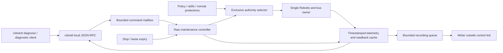

# Robot diagnostics and raw maintenance mode

**Proposal for review — not implemented.** This page owns the diagnostic session, its API and
records. Existing control and bus ownership belong to [robotd-design.md](robotd-design.md),
authority and transports to [architecture.md](architecture.md), deployment to
[updater-design.md](updater-design.md).

## 1. Purpose and agreed behaviour

Provide direct, observable access to **all 15 motors** for debugging, independently of the
walking policies and their behavioural protections. One execution path and API cover every
motor; no joint has a privileged implementation or commissioning order. Inspection, commanded
motion and recording should work with a robot lying down, supported or manually positioned.

This is an explicitly selected **raw maintenance mode**. During the session:

- Policies, skills, balancing, pickup pause, fall reactions and automatic recovery do not
  generate or modify motor commands. No pickup/support classifier or posture-qualified fixture
  profile is required to admit a test. Sensor verdicts remain visible as observations.
- Targets, RAM gains and torque state come from the diagnostic client. No anatomical clamp,
  collision avoidance or hidden trajectory smoothing changes a raw target. Unselected motors
  are unaffected unless explicitly declared in the session's torque plan.
- The existing robotd process remains the only bus owner. Diagnostics is not permission to
  open the UART from a second script.
- Explicit stop/relax, connection-loss termination, protocol validity and native servo limits
  remain defined. Native electrical/thermal shutdown is neither disabled nor advertised as
  software collision protection. A servo can refuse a command that the raw API accepts.
- Leaving maintenance never resumes a policy automatically. The ordinary robot's configuration
  and protections are unchanged outside the session.

The operator chooses the physical setup and commanded excursion. Raw mode can drive a joint
into a mechanical stop or collision: the UI must not label it protected or infer that a valid
command is mechanically safe. This is a mode contract, not an additional confirmation on each
command. Entering the explicit mode acknowledges that contract once per session.

This proposal changes the earlier protection-gated direction: diagnostic motion no longer
waits for pickup applicability, a new support classifier, fixture interlocks or anatomical
profile qualification. Those mechanisms are not prerequisites for this feature.

### Why this is needed

On baseline 0.17.9 (`96b89d8613f06722c1d64ce75ab0d7124fed9d8f`, API 44), joint telemetry exists,
but init moves all joints and skills replace the ordinary controller. There is no isolated
per-motor test API. Short asymmetric walking trials motivated investigation but do not identify
an electronic or physical zero error. An external USB camera makes movement visible, not
calibrated: a physical angle reference remains necessary for calibration conclusions.

## 2. Architecture



No additional daemon, UART connection or network listener. `robotd/src/diagnostics.rs` owns the
session state, command scheduling and optional experiment generator. IPC tasks validate shape,
authorization and message size, then submit bounded messages; only the control thread commits
authority, torque/gain writes and targets. A full mailbox returns `busy`, never an unbounded
backlog of movements. Stop uses a separate priority latch.

Refactor the target-selection and low-level write boundary so normal control keeps its existing
Safety path and raw maintenance deliberately bypasses its behavioural clamps. Do not bypass by
spoofing IMU data, modifying pickup features or setting global configuration flags. If the
current Safety wrapper prevents direct maintenance writes, factor its sole RobotIo ownership
into a shared actuator boundary selected by explicit authority; do not create two handles.
Keep the normal path's semantics unchanged and prove isolation in tests.

Read-only inspection uses cached fast telemetry and slow register reads scheduled by the bus
owner. Record the values observed before startup correction as well as expected values and
readback. Starting robotd can correct EEPROM; diagnostics.inspect/refresh must not call that
correcting function or pretend those startup writes did not happen. Additional register reads
have a measured bus budget and report unavailable/stale data instead of blocking the tick.

Existing services keep their devices and contracts: padd/configd for input/pairing, mediad for
camera/audio, tofd for depth/head sensing. The laptop CLI can assemble their read-only health
snapshots into a support bundle without inventing competing configuration routes. Passive
error-triggered recording may capture bus/IMU/loop failures with finite pre/post windows and
cooldowns; a diagnostic trigger never starts motion or repairs/restarts a service.

### Session and authority

States: `idle → acquired → active → stopping → acquired → closed`; failures may enter `faulted`.
Acquisition grants ownership without moving, enabling torque or homing. Refuse while another
controller is active: do not silently stop a walking robot. Clear pending normal intents on
entry/exit, reject normal actuator commands while owned, and prevent delayed pad/skill commands
from executing after release. Include head/look and mouth sources in the exclusion.

Tie the session to Unix peer credentials, its originating connection and robot boot epoch.
An opaque token prevents session mixups; it does not replace authorization. Reconnect may read
the report but cannot revive a lease or replay movement. All mutation requests have request IDs:
same ID/same payload returns the prior outcome; different payload is `request_conflict`.

A keepalive renews a server-monotonic deadline; candidate values for review are 100 ms renewal
and 300 ms expiry. Commands have explicit durations or validity deadlines, including a stationary
hold. This bounds operation after loss of the client without using pickup, fall or collision
logic. Explicit stop, connection close, lease expiry and duration completion apply the declared
stop action. Lease expiry cannot be disabled in v1. A camera is optional and does not gate motion.

Keep `robot.safeToRestart=false` throughout ownership, including torque-on holds. No automatic
policy resume, homing, pose restoration or re-energizing on exit. Invalidate gain/torque caches
changed by maintenance so the next explicit normal enable reapplies its configured settings.
A process crash or hung control thread cannot be stopped by an in-process deadline: document
and test actual servo behaviour on host loss. A hardware watchdog is a separate review decision,
not a claim that a classifier protects raw mode.

## 3. Full motor coverage and commands

Use JOINT_NAMES/JOINT_IDS from duck-ipc-proto, not the 14-action policy vector. The mouth is a
motor even though policies omit it.

| Motor | Bus ID |
|---|---:|
| `left_hip_yaw` | 20 |
| `left_hip_roll` | 21 |
| `left_hip_pitch` | 22 |
| `left_knee` | 23 |
| `left_ankle` | 24 |
| `neck_pitch` | 30 |
| `head_pitch` | 31 |
| `head_yaw` | 32 |
| `head_roll` | 33 |
| `mouth` | 34 |
| `right_hip_yaw` | 10 |
| `right_hip_roll` | 11 |
| `right_hip_pitch` | 12 |
| `right_knee` | 13 |
| `right_ankle` | 14 |

Every motor supports inspection, position commands, explicit torque enable/disable and RAM
position PID gain read/write through the same schema. Start with the existing position operating
mode. Current/PWM/velocity operating modes require a later explicit extension, not an implicit
mode switch. Native EEPROM limits and operating/drive modes remain visible, unchanged in v1.

Raw position commands accept a selected map of joint names to absolute radians. An optional
relative command explicitly references an immutable fresh measured snapshot ID; never silently
rebase a retried delta to a newer pose. Multiple selected joints can be written in one tick;
one-motor testing is the simple default, not an architectural restriction. Reject unsupported
backend operations instead of energizing all motors as a fallback.

Torque enable is a separate explicit operation. Before enabling a selected servo, seed its goal
with its fresh measured position while torque is off, verify the write, then enable; this avoids
moving to a forgotten goal from a previous session. Subsequent raw target writes have no hidden
slew limiter. Record the seeding sequence; failure leaves that servo off and reports the outcome.
Selective gain and torque operations must report partial success by motor: bus writes are not
an atomic transaction across fifteen devices. A failed compound operation latches failure and
performs the declared stop; it does not continue silently on the remaining subset.

Optional finite experiment helpers generate explicit targets: approach/hold/return, stepped
position, bidirectional sweep and repeated comparison. Parameters include amplitude, duration,
rate, repeats and optional gain. Smoothing and a return are properties of the chosen helper,
never injected into raw writes. Preview shows the exact generated trajectory and torque/gain
changes. A finite suite is a list of these calls across any/all motors, not a scripting language.
Mirrored comparison uses explicit side conventions; unpaired head/mouth motors use before/after
repeats. A skipped, missing or failed motor appears in the 15-entry coverage report.

Setup notes and recommended ranges can be recorded as metadata/presets, but are advisory in raw
mode. They cannot masquerade as validated collision protection or impose hidden admission gates.
Optional user-selected current/tracking/temperature abort thresholds belong to an experiment,
are listed in preview and reports, and default to absent in raw mode. Telemetry continues when
thresholds are absent. Native servo errors and transport/write failures remain explicit failures.

### Stop semantics

Choose the session stop action explicitly: proposed v1 is `torque_off` on the motors whose
torque the session enabled. An authorized robot.relax remains an all-joint emergency torque-off
without a session token. The exact treatment of motors already torqued at acquisition must be
settled before implementation; preview/status must expose the controlled torque set. Do not
silently extend that set to other joints or restore prior torque on release.

Stop does not return home or seek the initial pose. A helper returns only on its normal planned
completion; cancel/failure never triggers that return. Report requested stop, actual last command,
readback and `stopped` versus `stop_unconfirmed`. A bus fault can prevent physical confirmation;
a successful RPC is not proof that torque is off. Retain authority in a faulted state until the
operator resolves it. No recovery movement or reboot is automatic.

## 4. Proposed local API

JSON-RPC 2.0 on the existing /run/robotd.sock. All names below are new proposals. Implement typed
messages in duck-ipc-proto, bump API_VERSION and ship robotd/robotctl together. Report skew;
do not invent alternate interfaces for old versions.

### Inspection, telemetry and artifacts

| Method | Inputs | Result |
|---|---|---|
| `robot.diagnostics.inspect` | Optional sections: identity, motors, control, safety, policy, sensors | Cached snapshot ID/boot epoch, values, per-field times and validity |
| `robot.diagnostics.refresh` | Sections | Bounded read-only refresh operation; no corrective register writes |
| `robot.diagnostics.capabilities` | None | All 15 motors, supported backend operations, register ranges and units; no protection-profile gate |
| `robot.diagnostics.status` | Optional session ID | Owner, mode, active command/experiment, lease and torque/gain state |
| `robot.diagnostics.subscribe` | Rate 1..50 Hz, fields | Ordered telemetry/events with gaps, freshness and robot monotonic timestamps |
| `robot.diagnostics.record.start` | Label, max duration/bytes | Passive recorder ID, no torque/ownership change |
| `robot.diagnostics.record.stop` | Recording ID | Idempotent finalization and export ID |
| `robot.diagnostics.report` | Run or recording ID | Manifest, summaries and completeness |
| `robot.diagnostics.export.read` | Export/artifact ID, offset, bounded byte count | Finalized artifact chunk and digest; no arbitrary filesystem paths |

Motor entries expose joint/ID, installation identity/confidence, model/firmware, homing expected/
observed/startup preimage, operating/drive mode, hardware error, torque, P/I/D, native position/
velocity/current/PWM limits, voltage and temperature. Desired values and hardware readback are
separate. Null/unavailable is never zero. Diagnostic position is in the runtime coordinate
convention; also expose raw encoder counts with explicit units. Do not apply a second homing
offset in clients.

Expose generated, received, written and previous successful targets with write outcomes; policy
and config digests; loop timing, bus errors and repeated IMU data. Pickup/fall status remains
visible with `enforced:false` and reason `maintenance_raw`. If the pickup model is out of domain,
show applicability/validity rather than presenting its probability as a reliable lift verdict.

### Raw maintenance operations

| Method | Inputs | Effect |
|---|---|---|
| `robot.diagnostics.acquire` | Request ID, `mode:maintenance_raw`, explicit acknowledgement, stop action | Exclusive session/token and lease; no torque or motion |
| `robot.diagnostics.torque` | Session/token, request ID, selected joints, enabled | Explicit selective torque change with fresh-goal seeding on enable |
| `robot.diagnostics.gains` | Session/token, request ID, per-joint P/I/D | Write/readback RAM position gains; no persistent config change |
| `robot.diagnostics.command` | Session/token, request ID, selected absolute targets, validity duration | Direct position targets on the next accepted tick, no behavioural modification |
| `robot.diagnostics.prepare` | Session/token, request ID, finite experiment parameters | Resolve preview/digest, starting snapshot, writes, duration and optional abort criteria; no motion |
| `robot.diagnostics.run` | Session/token, request ID, plan ID/digest | Execute one finite helper experiment |
| `robot.diagnostics.keepalive` | Session/token, increasing sequence | Renew lease; never repeat or generate motion |
| `robot.diagnostics.stop` | Session/token or authorized administrative cancel, request ID | Priority stop with explicit confirmation status |
| `robot.diagnostics.release` | Session/token | Stop, then release; no normal-controller resumption |

No separate arm step is required: raw mode is entered explicitly once, and torque enable is
explicit. This keeps routine motor debugging direct. prepare/run is optional convenience;
command is available without a preview or a physical-protection readiness check.

Use local maintenance authorization based on Unix credentials, not socket reachability alone.
Do not expose these mutations through BLE/UDP/WebRTC/Space routes. Trusted SSH invokes the local
client; a locally running relay is still a relay, not an operator. Read refresh is rate-limited;
record creation is authorized and quota-limited. All messages are bounded and reject unknown
fields, unknown/duplicate joints, NaN/infinity, unrepresentable register values and wrong modes.
Protocol validation is not an anatomical limit. Hardware-representable targets are not silently
clipped; rejected and hardware-refused values are reported distinctly.

Results distinguish queued/committed/failed, include command/run sequence, applied tick and
per-motor outcome. Idempotency prevents repeating motion after a lost acknowledgement. Relevant
errors: unauthorized, controller_active, diagnostic_owned, unsupported_backend, wrong_mode,
invalid_value, stale_snapshot, stale_plan, bus_fault, lease_expired, request_conflict and
stop_unconfirmed. No protection_disabled/not_applicable/profile_unvalidated refusal in raw mode.

```json
{
  "jsonrpc": "2.0", "id": 7, "method": "robot.diagnostics.command",
  "params": {
    "session_id": "session-opaque", "token": "connection-bound",
    "request_id": "position-1",
    "positions_rad": {"left_hip_roll": 0.05},
    "valid_for_ms": 500
  }
}
```

This is a shape example, not an approved angle for a particular assembly. The same command
accepts every canonical joint, including mouth. It requires previously enabled selected torque;
writing a goal must never enable torque implicitly. On validity expiry, end that command with
the session stop action; keepalive alone does not extend an old target's validity. A new request
can explicitly extend/replace it. Relative commands use a separate unambiguous shape with
snapshot ID and deltas, not heuristic interpretation of positions_rad.

### CLI

One robotctl diagnose group:

```text
robotctl diagnose inspect --json
robotctl diagnose list
robotctl diagnose watch --joint head_roll
robotctl diagnose enter --mode maintenance-raw
robotctl diagnose torque --joint head_roll --on
robotctl diagnose position --joint head_roll --rad 0.05 --duration-ms 500
robotctl diagnose gains --joint head_roll --p 100 --i 0 --d 0
robotctl diagnose stop
robotctl diagnose report <run-id>
```

Proposed commands, unavailable on today's robot. A persistent interactive session owns the
connection/heartbeat; these subcommands execute inside that session, not as unrelated processes
that lose ownership immediately. A programmatic client uses the same connection-bound RPC API.
Entry displays the bypassed behaviours and explicit raw acknowledgement once. No hold-to-run,
camera readiness or per-command confirmation is required. Explicit --deg is a human convenience;
canonical wire/stored positions use radians. Status always labels maintenance_raw prominently.
Suites can offer setup pauses without requiring a classifier or a motor-specific admission path.

## 5. Timing, camera and records

Sensor read precedes the newly generated command in a tick. Record acquisition sequence,
received/generated target, actual write and outcome, and previous successful command sequence.
Same-tick error is not the settled response to the new target. Preserve position/velocity signs;
keep existing currents_ma magnitude semantics. Signed current is a new separately named raw
field, not a reinterpretation of policy/pickup inputs.

Robot monotonic timestamps and boot epoch order samples; UTC plus uncertainty labels sessions.
Registers have individual read times. Gaps, stale/coasted samples and drops are explicit. A
bounded ring and writer queue keep disk/network work out of the tick. Disk full or camera loss
marks recordings incomplete and is reported; raw motor commands are not silently interrupted
by evidence collection. An optional experiment abort rule can explicitly request that behaviour.
Reserve space for terminal events and bound retention/bytes/duration.

External USB capture stays on the laptop, onboard media in mediad. Neither gates motor access.
Video frame times plus host↔robot timestamp exchanges/RTT bounds provide approximate alignment,
not hardware-trigger accuracy. Capture video and reference measurements as explicit attachments;
support bundles omit media and credentials by default.

Each report includes identities/install generations, software/config/policy digests, raw-mode
bypass status, native register snapshots, selected torque/gains, commands and per-motor outcomes,
lease/stop events, timestamps/freshness, optional operator setup annotations and attachment hashes.
Summaries distinguish stable holds from transients: signed bias/MAE, settling time, overshoot,
current, thermal/voltage ranges and timing gaps. Unsettled data is not a valid zero measurement.
A failed, skipped, blocked or untested motor remains explicit in all-motor reports. Vetbook keeps
brief outcome links, not the full time series in its capped event list.

## 6. Calibration and persistence

Raw position/gain testing does not imply EEPROM write access. V1 never changes homing, drive/
operating mode, native shutdown/limits, replacement identity or DEFAULT_POSITION. These need a
separate explicit persistent transaction, preimage/readback and interruption recovery. No startup
correction is hidden in inspect/refresh. All RAM test changes and observed native restrictions
are recorded; a later normal enable explicitly reestablishes its own settings.

A later calibration workflow compares repeated external angle references across poses and
approach directions with uncertainty. Neither target error nor dynamic asymmetry identifies
horn alignment. Per-robot corrections would need one persistent source shared by startup,
adoption and maintenance, preserving policy coordinates and addressing old-release rollback.
Do not infer a physical serial number or transfer an old motor's reference to its replacement.

## 7. Implementation slices and validation

| Slice | Deliverable | Expected files |
|---|---|---|
| 1. Inspection | All-15 inventory, honest readback/startup preimages, timing and passive reports | duck-control/src/{io,bus}.rs; robotd/src/{main,diagnostics}.rs; duck-ipc-proto/src/{lib,diagnostics}.rs; robotctl/src/diagnostics.rs |
| 2. Raw session | Exclusive authority, scoped behavioural bypass, selective torque/gain and direct position API, stop/lease semantics | Existing Safety/RobotIo boundary, diagnostics modules, normal authority selection and params |
| 3. Recording and experiments | Finite helpers, suites, telemetry and camera associations for all 15 motors | Same controller/API plus reporting and laptop recorder; no extra execution daemon |

Test normal and maintenance paths separately. Raw commands must not be changed/refused because
of pickup, fall, missing IMU classifier, posture, advisory collision ranges, current/tracking
warnings or camera state. Normal mode must retain its original protections and features. Test
entry/exit/crash recovery without persistent protection/config changes or automatic policy resume.

Parameterize FakeIo tests over the exact 15 names/IDs, including mouth, selected write/torque/gain
sets, stale relative snapshots and absence of unintended activation. Cover ownership races,
retries, partial torque/gain failure, failed goal seeding, invalid/non-finite values, connection
close, command duration/lease expiry, recorder stalls, emergency stop with a full mailbox, and
confirmed versus unconfirmed stops. Enforce hardware value representation and selected operating
mode without adding hidden software motion constraints. Validate JSON and all transport denials.

Check helper trajectories/timing in simulation; it does not certify real friction/backlash or
mechanical clearance. Supervised bench validation uses the same protocol for all 15 motors, with
operator-chosen setups/targets and independent torque-off available. Measure actual write/read
ordering, selective torque/gains, lease stop latency, partial errors, loss-of-host behaviour and
normal-mode restoration. Publish those limitations rather than claiming raw mode is protected.
Update API_VERSION/roundtrips, CLI/docs and actual relay allow-lists. No installation, movement
or protection change on the real robot is part of this design PR.

## 8. Decisions remaining

1. Set exact target validity/lease durations and stop action, especially ownership of motors
   already torqued on entry. Verify behaviour after a host crash; decide whether to use the
   servo watchdog without conflating it with pickup/fall protection.
2. Choose RAM gain/torque readback semantics and recovery for partially successful operations.
   Define native range/mode validation and error reporting; no silent clipping.
3. Finalize typed command/relative/suite shapes, telemetry rates, disk budgets and retention.
4. Keep raw v1 in position mode with RAM PID/torque control; persistent calibration writes and
   additional actuator operating modes remain separate explicit extensions.

Agreed: raw maintenance is separate from normal operation, bypasses behavioural protections,
works uniformly across all 15 motors and retains one robotd bus owner. No new support/pickup
protection framework or physical-profile qualification is required before implementing it.
